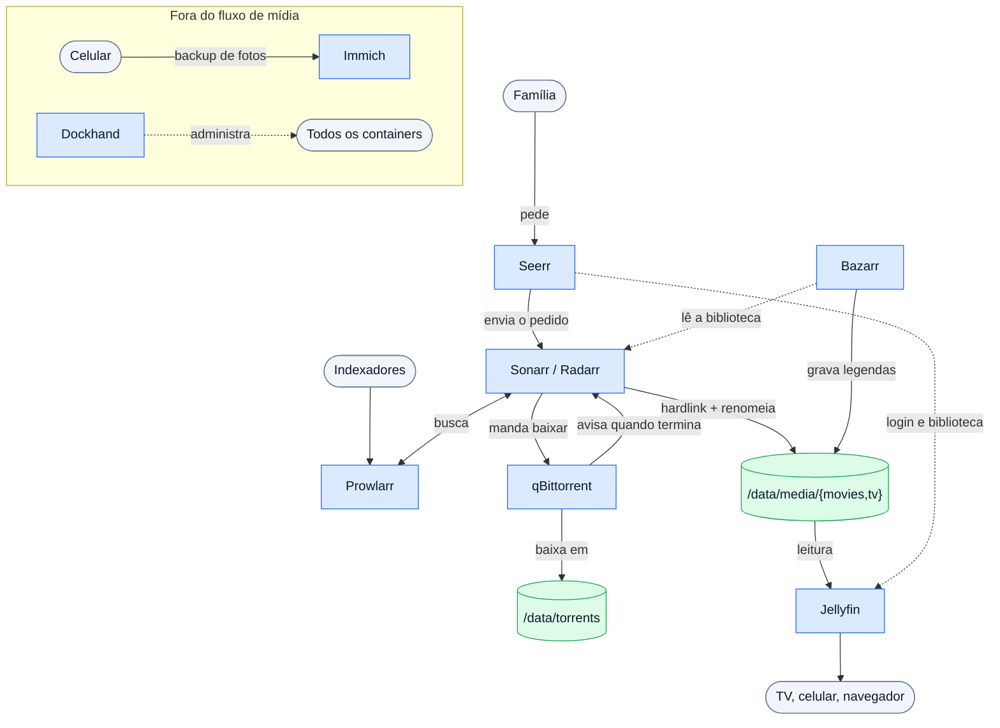

# midia-server-local

Servidor doméstico self-hosted com **streaming de filmes e séries**, **backup de fotos** e **gerenciamento de containers**, tudo rodando em Docker no seu próprio hardware, sem mensalidade e sem enviar seus dados para terceiros.

Este repositório é a **fonte da verdade** dos arquivos Docker: os `docker-compose.yml` ficam versionados aqui, e os segredos de cada máquina ficam em arquivos `.env` locais (ignorados pelo Git).

## Aplicações

| Aplicação | Categoria | Finalidade | Porta | Projeto |
|---|---|---|---|---|
| [Jellyfin](docs/aplicacoes.md#jellyfin) | Mídia | Servidor de streaming (reproduz) | 8096 | `media` |
| [Radarr](docs/aplicacoes.md#radarr) | Automação | Gerencia **filmes** | 7878 | `media` |
| [Sonarr](docs/aplicacoes.md#sonarr) | Automação | Gerencia **séries** | 8989 | `media` |
| [Bazarr](docs/aplicacoes.md#bazarr) | Automação | Baixa e sincroniza **legendas** | 6767 | `media` |
| [Prowlarr](docs/aplicacoes.md#prowlarr) | Automação | Central de **indexadores** | 9696 | `media` |
| [qBittorrent](docs/aplicacoes.md#qbittorrent) | Download | Cliente de torrent | 8080 (web), 6881 (peers) | `media` |
| [Seerr](docs/aplicacoes.md#seerr) | Pedidos | Interface para **pedir** filmes/séries | 5055 | `media` |
| [Immich](docs/aplicacoes.md#immich) | Fotos | Backup e galeria de fotos/vídeos | 2283 | `immich` |
| [Dockhand](docs/aplicacoes.md#dockhand) | Administração | Interface web para o Docker | 3000 | `dockhand` |

O conjunto Radarr, Sonarr, Bazarr e Prowlarr é conhecido como **stack \*arr**. O que cada aplicação faz, com quem conversa e onde guarda os dados: [Aplicações](docs/aplicacoes.md).

## Como tudo se conecta



Linhas contínuas são o fluxo principal; tracejadas são relações de apoio. O Immich e o Dockhand não participam do caminho de um filme até a tela.

As dependências de inicialização entre os serviços e o motivo da pasta única `/data` (hardlinks) estão em [Aplicações](docs/aplicacoes.md#dependências-entre-os-serviços).

## Início rápido

Precisa de Linux 64-bit com **Docker + Compose v2**, **git** e **make** (instalação: [Requisitos e dependências](docs/requisitos-e-instalacao.md)). O repositório é **privado**: faça login no GitHub antes de clonar ([como](docs/setup-passo-a-passo.md#passo-5-clonar-o-repositório)).

```bash
sudo install -d -o "$USER" -g "$(id -gn)" /srv/stacks
git clone https://github.com/ggabriell455/midia-server-local.git /srv/stacks
cd /srv/stacks
make up
```

O `make up` confere as dependências, cria os `.env` e as pastas (pede a senha do `sudo` para criar as de `/srv`), valida os compose e sobe tudo. Depois, [configure cada aplicação](docs/configuracao-inicial.md) pelo navegador.

O `make` é um **atalho**, não um substituto do [setup passo a passo](docs/setup-passo-a-passo.md): cada alvo executa passos manuais e mostra os comandos que roda.

| Comando | O que faz |
|---|---|
| `make up` | Faz tudo até ficar de pé |
| `make stop` | Para tudo (nada é removido) |
| `make clean` | Remove containers, redes, volumes e imagens; **os dados ficam** |
| `make purge` | O `clean` mais a **remoção dos dados** e dos `.env` (confirmação digitada) |

Todos os alvos, o que cada um faz e as proteções do `purge`: [Atalhos com `make`](docs/atalhos-make.md).

> **Antes de expor na rede:** o Docker ignora o ufw/firewalld para portas publicadas, então **não faça port-forward** no roteador (para acesso remoto use o [Tailscale](docs/operacao-backup-acesso.md#acesso-remoto)); **ative a autenticação do Dockhand** no primeiro acesso (ela vem desativada e ele controla o Docker do servidor); e nunca versione os `.env`. Detalhes: [Segurança](docs/solucao-de-problemas.md#segurança).

## Estrutura do repositório

```
midia-server-local/
├── README.md
├── .gitignore               # ignora os .env (segredos)
├── Makefile                 # atalhos: make up / stop / clean
├── docs/                    # documentação detalhada (índice abaixo)
├── media/
│   ├── docker-compose.yml   # Jellyfin, Radarr, Sonarr, Bazarr, Prowlarr, qBittorrent, Seerr
│   └── .env.example
├── immich/
│   ├── docker-compose.yml   # cópia sem alterações do compose oficial (v3.2.2)
│   └── .env.example
└── dockhand/
    ├── docker-compose.yml   # Dockhand (projeto separado de propósito)
    └── .env.example
```

Cada pasta é um **projeto Compose independente**, com seu próprio `.env`. O Dockhand fica separado porque não deve ser parado nem recriado por uma stack que ele mesmo administra.

## Documentação

| Documento | O que você encontra |
|---|---|
| [Aplicações](docs/aplicacoes.md) | O que cada aplicação faz, dependências entre os serviços e por que existe a pasta única `/data` |
| [Requisitos e dependências](docs/requisitos-e-instalacao.md) | Hardware, software necessário e instalação do Docker/Compose |
| [Setup passo a passo](docs/setup-passo-a-passo.md) | O processo manual completo, com as pastas do servidor e as variáveis dos `.env` |
| [Atalhos com `make`](docs/atalhos-make.md) | Todos os alvos do Makefile, fluxos típicos e proteções do `purge` |
| [Configuração inicial](docs/configuracao-inicial.md) | Configurar cada aplicação pelo navegador, na ordem certa |
| [Operação, backup e acesso remoto](docs/operacao-backup-acesso.md) | Comandos do dia a dia, atualização, backup, Tailscale e fluxo de trabalho com Git |
| [Solução de problemas e segurança](docs/solucao-de-problemas.md) | Tabela de sintomas e soluções e práticas de segurança |

## Referências

- [Jellyfin](https://jellyfin.org/docs/) · [Servarr Wiki (Sonarr, Radarr, Prowlarr)](https://wiki.servarr.com/) · [Bazarr](https://wiki.bazarr.media/)
- [TRaSH Guides](https://trash-guides.info/): estrutura de pastas, hardlinks e perfis de qualidade
- [Seerr](https://docs.seerr.dev/) · [Immich](https://docs.immich.app/) · [Dockhand](https://dockhand.pro/manual/)
- [LinuxServer.io](https://docs.linuxserver.io/): imagens usadas em Jellyfin, Sonarr, Radarr, Bazarr, Prowlarr e qBittorrent
- [Docker Engine: instalação](https://docs.docker.com/engine/install/) · [Tailscale](https://tailscale.com/kb)

## Aviso legal

Todas as aplicações listadas são software legítimo. Use as ferramentas de download **apenas para obter conteúdo que você tem o direito de acessar**: obras próprias, de domínio público, com licença livre ou cópias que você possui legalmente. A responsabilidade pelo uso é de quem opera o servidor.
